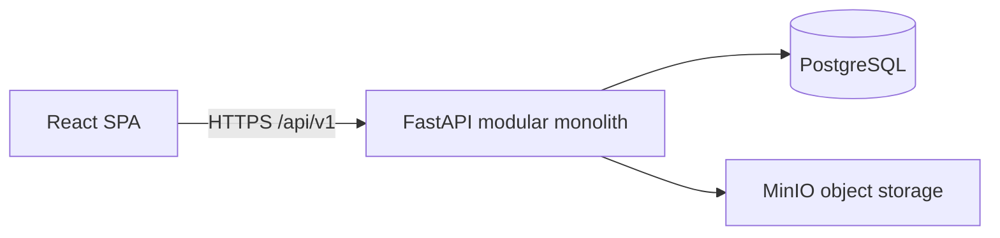

# MyNagari Technical Specification

Status: design baseline for implementation  
Stack: Python FastAPI, React with Material UI, PostgreSQL, Docker

## 1. Purpose and scope

MyNagari is a smart-city consumer application. A resident uses one account for daily city life and local commerce: a ward climate summary, civic issue reports, waste schedules, water and electricity bills, public parking, city notices, public facilities, plus groceries, restaurant food, local transport, and a second-hand marketplace. Reviews and ratings attach to the services and places those modules expose.

This document is the architecture and delivery plan for the first release. It names the modules, the shared domain language, the relational schema, the HTTP API, the two viewing modes, and the order in which vertical slices are built.

### In scope

- Civic issue reports with photo and status tracking (pothole, streetlight, water leak, garbage, drainage, missed pickup)
- Waste collection day and time by ward
- Water and electricity bills linked to a consumer number, with payment through the shared payment port
- Public parking search, hourly price, and a timed reservation
- City notices and alerts, including ward-specific and citywide messages
- A directory of clinics, parks, public toilets, EV chargers, and ward offices
- Ward climate on the city home: temperature, sky condition, humidity, and air quality, plus the other city services on the same page
- The city home lays out on a narrow screen and a wide screen in both Modern and Normal view
- Grocery browse, search, cart, home delivery checkout, and order history
- Restaurant listings, menus, food checkout, and order tracking
- Local transport search and booking, plus a data boundary for later tourism content
- Second-hand listings, purchase, and buyer–seller messaging
- Ratings and written reviews, with average rating and rating count on each target
- Registration, login, profile, ward, saved addresses, and a persisted interface mode
- Docker Compose for a local system that runs the API, the web app, the database, and object storage

### Out of scope for this release

- Native mobile clients
- A merchant or admin web console
- A live payment provider (checkout calls a payment port; the shipped adapter records a captured payment)
- A recommendation engine, live GPS tracking, and a tourism catalog
- Live control of city infrastructure (signals, sensors, or dispatch). Operators publish readings, notices, bills, and report status into MyNagari
- Multi-currency and multi-city tenancy

Tourism, a real payment provider, and merchant logins are extension points. They are named where they touch the schema or the API, and they are not built in the slices below.

## 2. Actors and main use cases

| Actor | Who they are | What they do in this release |
| --- | --- | --- |
| Resident | A registered user | Reports civic issues, pays utility bills, reserves parking, shops, orders food, books transport, messages sellers, writes reviews, manages a profile |
| Seller | The same resident, acting on their own listing | Creates and updates listings, answers messages, receives a purchase |
| Operator | A platform process holding an operator credential | Advances delivery and travel status, updates civic reports, publishes notices and climate readings, and posts utility bills |
| Guest | An anonymous browser | Reads the city home (climate, notices, waste, parking, facilities); browses catalogs and listings; registers to report, pay, book, or buy |

A resident and a seller are the same `users` row. Authorization is based on ownership and participation, not on a permanent buyer or seller role.

### Use cases

1. Register, log in, set a display name, choose a ward, choose Modern or Normal view, and save a delivery address.
2. Open the city home, read the ward climate and any alert, then open waste, a bill, parking, or facilities from that same page.
3. File a civic report with a place description and a photo, then follow it from submitted to resolved.
4. Link a water or electricity consumer number, view the due bill, and pay it.
5. Find a public parking lot with free space, reserve an hour, and see the session under activity.
6. Look up a clinic, park, public toilet, EV charger, or ward office.
7. Search groceries, add quantities to a cart, place a home-delivery order, and read it later in order history.
8. Open a restaurant, add menu items, place a food order, and watch status move through preparation and delivery.
9. Search a local route, pick a departure, book seats, and see the booking under activity.
10. Publish a second-hand listing with photos, browse someone else's listing, message them, and buy the item.
11. After a completed grocery order, food order, trip, marketplace purchase, parking session, or the order itself, submit one rating and review. Averages show on the target. A resident may also review a public facility once.

## 3. System architecture

MyNagari ships as a modular monolith. City services, grocery, food, travel, marketplace, reviews, and identity live in one FastAPI process and one PostgreSQL database. They share users, wards, addresses, money, the payment port, and reviews. One deployable matches a single product with one team-sized release train and transactions that must update stock, a parking lot, or an order together.

A module becomes a separate service only when it needs an independent release cycle or a different scaling profile. Messaging storage and image processing are the first candidates. Until then they stay in-process, with messaging writes and image checks isolated behind module interfaces.



### Runtime processes

| Process | Responsibility |
| --- | --- |
| `web` | Nginx serves the React build and proxies `/api/` to the API |
| `api` | Uvicorn serves FastAPI. Workers are stateless |
| `postgres` | System of record for users, civic records, catalogs, orders, bookings, listings, messages, and reviews |
| `minio` | Avatars, civic-report photos, and listing photos. The database stores object keys |

PostgreSQL is the system of record because orders, seats, stock, and listings need foreign keys, unique constraints, and transactions. Document storage would push those rules into application code.

Money is an integer number of paise (INR × 100) in `bigint` columns. A charge of ₹12.50 is `1250`. Floating point is not used for prices or totals.

### Authentication placement

The browser holds a short-lived JWT access token in memory. A refresh token is an opaque random value in an `HttpOnly` cookie. The API hashes the refresh token at rest. Authorization checks run in each module after the shared identity dependency resolves the caller.

### Payment placement

Grocery checkout, food checkout, travel booking, marketplace purchase, utility-bill payment, and parking reservation all create a `payments` row, then call `PaymentGateway.capture`. The v1 adapter is `StubGateway`, which marks the payment `captured` in the same transaction as the charge. A later adapter can call an external provider without changing those modules. The port is:

- Input: payment id, amount in paise, idempotency key
- Output: `captured` or `failed`, plus a provider reference

### Operational status

Food tracking, grocery progress, completed trips, civic-report progress, city notices, utility bills, and ward climate readings need updates after the resident acts, or on a city schedule. This release exposes a narrow operator API protected by a dedicated `OPERATOR_TOKEN`. There is no operator user interface. The resident app polls orders, bookings, and open civic reports.

### Request path

1. Nginx terminates the browser connection in production and forwards `/api/*` to Uvicorn.
2. Middleware assigns a request id, applies a body size limit, and sets security headers.
3. The router dependency validates the access token when the route requires it.
4. The module service opens a transaction, checks ownership and stock or listing state, and commits.
5. Response models return only the fields defined for that route. Internal ids of other users stay off payloads except the display name a buyer or seller must see.

## 4. Module boundaries and interactions

### Shared kernel

| Concept | Owner | Consumed by |
| --- | --- | --- |
| User, profile, credential, refresh token | Identity | Every module |
| Ward | City | Waste schedules, reports, notices, facilities, parking, climate readings, addresses |
| Address | Identity | Grocery and food checkout; profile; civic reports |
| Money (paise integers) | Shared types | Catalogs, carts, orders, bookings, listings, bills, parking, payments |
| Payment | Payments | Grocery checkout, food checkout, travel booking, marketplace purchase, utility bills, parking |
| Review and rating aggregate | Reviews | Grocery product, restaurant, travel route, listing, order, parking lot, facility |
| Object storage | Media | Avatars, civic-report photos, listing photos |
| Idempotency record | Shared | Order, booking, purchase, bill payment, and parking reservation |

### Domain modules

| Module | Owns | Does not own |
| --- | --- | --- |
| City | Wards, civic reports, waste schedules, utility accounts and bills, parking lots and sessions, notices, facilities, climate readings | Commerce orders and the payment row shape |
| Grocery | Categories, products, stock, the grocery cart | The order row shape |
| Food | Restaurants, menu items, the per-restaurant cart | The order row shape |
| Ordering | `orders`, `order_lines`, `order_status_events` for channels `grocery` and `food` | Catalog prices after the line is snapshotted |
| Travel | Routes, departures, bookings | Tourism content |
| Market | Listings, listing images, purchases, conversations, messages | Platform delivery orders |
| Reviews | Review rows and the rules for who may write one | The parent entity, beyond updating its aggregate |

### City services sit beside commerce

City services share identity, wards, addresses, payments, media, and reviews with the rest of MyNagari. They keep their own records because a pothole report, a utility bill, and a parking hour are not delivery orders.

| Service | Resident action | Shared pieces |
| --- | --- | --- |
| Civic reports | Describe an issue, attach one photo, and follow status | Address snapshot, media, operator status events |
| Waste schedule | Read the collection day for the profile ward | Ward. A missed pickup is a civic report with category `missed_pickup`, so waste does not grow a second ticket system |
| Utility bills | Link a water or electricity consumer number and pay the due bill | Payment port. The operator posts the amount; MyNagari does not call the utility |
| Public parking | Reserve a free slot for a start and end time and pay the hourly total | Payment port, row lock on the lot, reviews after a completed session |
| City notices | Read citywide and ward alerts | Ward. Guests can read published notices |
| Public facilities | Find a clinic, park, toilet, EV charger, or ward office | Ward, reviews |
| Climate | Read temperature, sky condition, humidity, and air quality for the ward | Ward. The operator records one climate snapshot. The city home is the only climate screen in this release |

The City home is the signed-in landing page and the guest landing page. A live city pulse (water, power, transit, air) sits above climate. The other city services sit on the same page: notices, today's waste window, report an issue, pay a bill, parking spaces free, and facilities. Commerce stays in the navigation. The page reflows for a narrow screen and a wide screen in both view modes, as specified in section 9.

A parking reservation locks the lot row and succeeds only while `occupied < capacity`. The session stores the price snapshot. Cancelling a session that has not started frees the slot and marks the payment `refunded` through the stub gateway. Two residents reserving the last slot produce one success and one `409 parking_full`.

Utility payment uses the same idempotency rule as checkout. A bill already `paid` returns `409 bill_already_paid` on a new attempt with a different key.

### Grocery and food share one order aggregate

Grocery and food both describe platform-mediated delivery: a buyer, a snapshotted set of lines, a delivery address, a payment, and the same status sequence (`placed`, `accepted`, `preparing`, `out_for_delivery`, `delivered`, `cancelled`). They are one `orders` aggregate with `channel` of `grocery` or `food`.

The catalogs stay separate. A grocery line references `grocery_products`. A food line references `menu_items` and requires `orders.restaurant_id`. The cart is also split by channel so a grocery basket and a restaurant basket cannot mix lines. Food carts are one open cart per user per restaurant. Adding an item from a different restaurant returns `409 cart_restaurant_conflict`; the client confirms replacement, then the API clears the previous restaurant cart.

Stock and availability change inside the checkout transaction:

- Grocery decrements `grocery_products.stock_qty` with a conditional update (`stock_qty >= quantity`).
- Food checks `menu_items.is_available` and the restaurant `is_open` flag. Food does not track ingredient stock in this release.

### Marketplace purchases stay beside platform orders

A second-hand sale is a peer exchange. It has a seller who is a user, a listing that can be reserved or withdrawn, and a conversation. Those facts do not fit the delivery order lifecycle. `marketplace_purchases` records the sale. It still uses the shared payment port and the shared user id.

Purchase uses compare-and-set on the listing: `status` moves from `active` to `sold` only if it is still `active`. Two buyers cannot both succeed. The loser’s request returns `409 listing_unavailable`.

### Travel

A booking reserves seats on a departure. It is not a cart. `travel_departures.seats_left` decrements in the same transaction as the booking and the payment. Routes carry `service_kind` of `transport` or `tour`. This release writes only `transport`. A later tourism module can insert `tour` routes and departures and reuse `bookings` without a new purchase table.

### Reviews attach by target type

One `reviews` table serves every module. `target_type` is `grocery_product`, `restaurant`, `travel_route`, `listing`, `order`, `parking_lot`, or `facility`. The service checks eligibility, inserts the review, and updates the denormalized `rating_avg` and `rating_count` on the parent in the same transaction.

| Target | Who may review |
| --- | --- |
| `grocery_product` | Buyer on a `delivered` grocery order that contains that product |
| `restaurant` | Buyer on a `delivered` food order for that restaurant |
| `travel_route` | Passenger on a `completed` booking for a departure of that route |
| `listing` | Buyer on a `completed` marketplace purchase of that listing |
| `order` | Buyer of that order once status is `delivered`, one review per order |
| `parking_lot` | Resident with a `completed` parking session at that lot |
| `facility` | Any active user, one review per facility |

### Account and listing lifecycle side effects

Closing an account sets `users.deleted_at`, revokes refresh tokens, and clears `display_name`, phone, and avatar. Email is replaced with an irreversible placeholder so the unique login cannot be reused by the closed row and the original address is not retained. Orders, bookings, purchases, civic reports, parking sessions, and messages remain so city operations and accounting history stay intact. Utility consumer numbers are replaced with a placeholder because they identify a household account. Message sender display resolves to "Deleted user" when `deleted_at` is set. Active listings move to `withdrawn`. A listing with a `paid` or `completed` purchase cannot be withdrawn; the purchase finishes first.

Withdrawing an `active` listing sets `withdrawn` and rejects new purchases. Withdrawing is refused when a purchase is already `paid` or `completed`.

## 5. Domain model

### Identity

- **User.** Login identity. Email is the credential. Status is `active`, `suspended`, or `deleted`.
- **Profile.** Display name, avatar object key, home ward, interface mode (`modern` or `normal`).
- **Address.** A saved delivery location owned by one user, optionally tied to a ward. Checkout copies the fields onto the order so later edits do not rewrite history.
- **Ward.** A named area of the city. Waste days, notices, facilities, parking, climate readings, and reports hang off a ward.

### City

- **Civic report.** A resident's issue: category, ward, place description, one photo, and a status timeline.
- **Waste window.** The weekday and clock window when a ward's wet, dry, or mixed waste is collected.
- **Utility account.** A water or electricity consumer number saved by one user.
- **Utility bill.** An amount due for one account and one period. Paying it captures a payment.
- **Parking lot.** A public lot with a capacity, hourly price, and open flag. Occupancy is the count of active sessions.
- **Parking session.** A paid reservation with a start, an end, and a price snapshot.
- **City notice.** A published alert for the whole city or one ward, with severity `info`, `warning`, or `emergency`.
- **Facility.** A public place: `clinic`, `park`, `toilet`, `ev_charger`, or `ward_office`.
- **Climate reading.** The latest ward snapshot: temperature in Celsius, sky condition (`clear`, `cloudy`, `rain`, `storm`, `heat`), humidity percent, air-quality index, and air category (`good`, `moderate`, `poor`, `severe`).

### Catalog

- **Grocery product.** Sellable unit with a price in paise, a unit label such as `piece` or `kg`, and an on-hand quantity.
- **Restaurant.** A kitchen the platform lists. v1 has no restaurant login; staff status changes go through the operator API.
- **Menu item.** One priced dish belonging to one restaurant.

### Platform commerce

- **Cart.** An open basket for `grocery`, or for one restaurant.
- **Order.** Immutable commercial snapshot for grocery or food: lines, address snapshot, totals, status.
- **Order line.** Name, unit price, and quantity copied at checkout.
- **Order status event.** Append-only history that the tracking screen renders.

### Travel

- **Route.** Origin, destination, mode (`bus`, `metro`, `taxi`), operator, and `service_kind`.
- **Departure.** One running of a route with a clock time, price, and remaining seats.
- **Booking.** Seats held by one user on one departure.

### Marketplace

- **Listing.** A seller’s offer. Status moves `draft` → `active` → `sold`, or `active` → `withdrawn`.
- **Purchase.** Buyer, seller, listing, price snapshot, payment, status `paid` or `completed` or `cancelled`.
- **Conversation.** One thread per listing and buyer. The seller is the listing owner.
- **Message.** A plain-text body from one participant.

### Cross-cutting

- **Payment.** Amount, status (`pending`, `captured`, `failed`, `refunded`), and the payable it settles (`order`, `booking`, `marketplace_purchase`, `utility_bill`, or `parking_session`).
- **Review.** Author, target type, target id, integer score from 1 to 5, and optional text.
- **Idempotency key.** Client-generated key stored with the user so a retried checkout returns the original result.

### Status sequences

```text
Order:     placed → accepted → preparing → out_for_delivery → delivered
                 ↘ cancelled (from any state before delivered)

Booking:   confirmed → completed
                 ↘ cancelled

Listing:   draft → active → sold
                      ↘ withdrawn

Purchase:  paid → completed
             ↘ cancelled

Civic report: submitted → acknowledged → in_progress → resolved
                    ↘ rejected (from submitted or acknowledged)

Utility bill: due → paid

Parking:   reserved → completed
               ↘ cancelled (before starts_at)
```

Cancellation of a delivered order is out of band for this release. Cancelling a `placed` or `accepted` grocery order returns stock. Cancelling a booking returns seats. Cancelling a parking session before `starts_at` frees the slot. Each of those sets the payment to `refunded` through the stub gateway.

## 6. Database schema

Engine: PostgreSQL 16.  
Extensions: `pg_trgm` for catalog and listing search.  
Primary keys: `uuid` default `gen_random_uuid()`.  
Timestamps: `timestamptz` in UTC.  
Money: `bigint` paise, check constraint `>= 0`.

Soft deletion applies to users (`deleted_at`). Commercial rows stay. Listings and products use status or `is_active` so history can still resolve a name.

### users

| Column | Type | Notes |
| --- | --- | --- |
| id | uuid | Primary key |
| email | text | Unique index on `lower(email)` |
| password_hash | text | Argon2id |
| status | text | `active`, `suspended`, `deleted` |
| created_at | timestamptz | |
| deleted_at | timestamptz | Null while active |

### profiles

| Column | Type | Notes |
| --- | --- | --- |
| user_id | uuid | Primary key, foreign key to `users.id` |
| display_name | text | Required, 1–80 characters |
| avatar_key | text | Nullable MinIO key |
| ward_id | uuid | Nullable foreign key to `wards.id`. City home uses this ward |
| ui_mode | text | `modern` or `normal`, default `modern` |

### addresses

| Column | Type | Notes |
| --- | --- | --- |
| id | uuid | Primary key |
| user_id | uuid | Foreign key to `users.id` |
| label | text | Example: Home |
| line1 | text | |
| line2 | text | Nullable |
| city | text | |
| region | text | |
| postal_code | text | |
| ward_id | uuid | Nullable foreign key to `wards.id` |
| is_default | boolean | At most one true per user; partial unique index on `(user_id)` where `is_default` |

Index: `(user_id)`.

### refresh_tokens

| Column | Type | Notes |
| --- | --- | --- |
| id | uuid | Primary key |
| user_id | uuid | Foreign key |
| token_hash | text | Unique. Store a hash, not the cookie value |
| expires_at | timestamptz | |
| revoked_at | timestamptz | Nullable |
| created_at | timestamptz | |

Index: `(user_id)` where `revoked_at` is null.

### wards

| Column | Type | Notes |
| --- | --- | --- |
| id | uuid | Primary key |
| name | text | |
| code | text | Unique, short ward code |

### civic_reports

| Column | Type | Notes |
| --- | --- | --- |
| id | uuid | Primary key |
| user_id | uuid | Foreign key, reporter |
| ward_id | uuid | Foreign key |
| category | text | `pothole`, `streetlight`, `water_leak`, `garbage`, `drainage`, `missed_pickup`, `other` |
| description | text | 1–2000 characters |
| place_text | text | Street or landmark. Shown to the reporter and the operator |
| photo_key | text | Nullable MinIO key. At most one photo |
| status | text | `submitted`, `acknowledged`, `in_progress`, `resolved`, `rejected` |
| created_at | timestamptz | |

Indexes: `(user_id, created_at desc)`, `(ward_id, status, created_at desc)`.

### civic_report_events

| Column | Type | Notes |
| --- | --- | --- |
| id | uuid | Primary key |
| report_id | uuid | Foreign key |
| status | text | |
| note | text | Nullable |
| created_at | timestamptz | |

Index: `(report_id, created_at)`.

### waste_schedules

| Column | Type | Notes |
| --- | --- | --- |
| id | uuid | Primary key |
| ward_id | uuid | Foreign key |
| weekday | smallint | `0` Monday through `6` Sunday |
| waste_type | text | `wet`, `dry`, `mixed` |
| window_label | text | Example: `07:00–09:00` |

Unique: `(ward_id, weekday, waste_type)`.

### utility_accounts

| Column | Type | Notes |
| --- | --- | --- |
| id | uuid | Primary key |
| user_id | uuid | Foreign key |
| kind | text | `water` or `electricity` |
| consumer_number | text | Household account id at the utility |
| label | text | Resident's name for the account |

Unique: `(user_id, kind, consumer_number)`.  
Index: `(user_id)`.

### utility_bills

| Column | Type | Notes |
| --- | --- | --- |
| id | uuid | Primary key |
| account_id | uuid | Foreign key |
| period_label | text | Example: `2026-10` |
| amount_paise | bigint | |
| due_on | date | |
| status | text | `due` or `paid` |
| idempotency_key | text | Nullable until the resident pays |

Unique: `(account_id, period_label)`.  
Index: `(account_id, status)`.

### parking_lots

| Column | Type | Notes |
| --- | --- | --- |
| id | uuid | Primary key |
| ward_id | uuid | Foreign key |
| name | text | |
| address_text | text | |
| capacity | integer | Check `> 0` |
| price_paise_per_hour | bigint | |
| is_open | boolean | |
| rating_avg | numeric(2,1) | Default 0 |
| rating_count | integer | Default 0 |

Occupied spaces are `count(*)` of `parking_sessions` for the lot where `status = 'reserved'` and `ends_at > now()`.  
Index: `(ward_id, is_open)`, GIN trigram on `name`.

### parking_sessions

| Column | Type | Notes |
| --- | --- | --- |
| id | uuid | Primary key |
| user_id | uuid | Foreign key |
| lot_id | uuid | Foreign key |
| starts_at | timestamptz | |
| ends_at | timestamptz | Must be after `starts_at`. This release allows 1 to 8 hours |
| amount_paise | bigint | Hourly price times the billed hours, snapshotted |
| status | text | `reserved`, `completed`, `cancelled` |
| idempotency_key | text | |
| created_at | timestamptz | |

Unique: `(user_id, idempotency_key)`.  
Index: `(lot_id, status, ends_at)`, `(user_id, created_at desc)`.

### city_notices

| Column | Type | Notes |
| --- | --- | --- |
| id | uuid | Primary key |
| ward_id | uuid | Nullable foreign key. Null means the whole city |
| title | text | |
| body | text | |
| severity | text | `info`, `warning`, `emergency` |
| starts_at | timestamptz | |
| ends_at | timestamptz | |
| published | boolean | Guests see rows where `published` is true and the clock is inside the window |

Index: `(published, starts_at desc)`, `(ward_id, published)`.

### facilities

| Column | Type | Notes |
| --- | --- | --- |
| id | uuid | Primary key |
| ward_id | uuid | Foreign key |
| kind | text | `clinic`, `park`, `toilet`, `ev_charger`, `ward_office` |
| name | text | |
| address_text | text | |
| opening_hours | text | |
| phone | text | Nullable |
| rating_avg | numeric(2,1) | Default 0 |
| rating_count | integer | Default 0 |

Indexes: `(ward_id, kind)`, GIN trigram on `name`.

### climate_readings

| Column | Type | Notes |
| --- | --- | --- |
| id | uuid | Primary key |
| ward_id | uuid | Foreign key |
| temperature_c | numeric(4,1) | Celsius |
| condition | text | `clear`, `cloudy`, `rain`, `storm`, `heat` |
| humidity_pct | smallint | Check `between 0 and 100` |
| aqi | integer | Check `>= 0` |
| aqi_category | text | `good`, `moderate`, `poor`, `severe` |
| recorded_at | timestamptz | |

Index: `(ward_id, recorded_at desc)`. City home and `GET /city/climate` return the newest row.

### grocery_categories

| Column | Type | Notes |
| --- | --- | --- |
| id | uuid | Primary key |
| name | text | |
| slug | text | Unique |
| parent_id | uuid | Nullable self foreign key |

### grocery_products

| Column | Type | Notes |
| --- | --- | --- |
| id | uuid | Primary key |
| category_id | uuid | Foreign key |
| sku | text | Unique |
| name | text | |
| description | text | |
| unit_label | text | `piece`, `kg`, `litre` |
| unit_price_paise | bigint | |
| stock_qty | integer | Check `>= 0` |
| is_active | boolean | |
| image_key | text | Nullable |
| rating_avg | numeric(2,1) | Default 0 |
| rating_count | integer | Default 0 |

Indexes: `(category_id, is_active)`, GIN trigram on `name`.

### restaurants

| Column | Type | Notes |
| --- | --- | --- |
| id | uuid | Primary key |
| name | text | |
| description | text | |
| city | text | |
| is_open | boolean | |
| image_key | text | Nullable |
| rating_avg | numeric(2,1) | |
| rating_count | integer | |

Indexes: `(city, is_open)`, GIN trigram on `name`.

### menu_items

| Column | Type | Notes |
| --- | --- | --- |
| id | uuid | Primary key |
| restaurant_id | uuid | Foreign key |
| name | text | |
| description | text | |
| price_paise | bigint | |
| is_available | boolean | |
| sort_order | integer | |

Index: `(restaurant_id, sort_order)`.

### travel_routes

| Column | Type | Notes |
| --- | --- | --- |
| id | uuid | Primary key |
| service_kind | text | `transport` in this release; `tour` reserved |
| mode | text | `bus`, `metro`, `taxi` |
| operator_name | text | |
| origin | text | |
| destination | text | |
| summary | text | |
| rating_avg | numeric(2,1) | |
| rating_count | integer | |
| extension | jsonb | Empty object. Tourism metadata lands here later |

Index: `(service_kind, origin, destination, mode)`.

### travel_departures

| Column | Type | Notes |
| --- | --- | --- |
| id | uuid | Primary key |
| route_id | uuid | Foreign key |
| departs_at | timestamptz | |
| arrives_at | timestamptz | |
| price_paise | bigint | |
| seats_left | integer | Check `>= 0` |

Index: `(route_id, departs_at)`.

### carts

| Column | Type | Notes |
| --- | --- | --- |
| id | uuid | Primary key |
| user_id | uuid | Foreign key |
| channel | text | `grocery` or `food` |
| restaurant_id | uuid | Null for grocery; required for food |

Unique: `(user_id)` where `channel = 'grocery'`.  
Unique: `(user_id, restaurant_id)` where `channel = 'food'`.

### cart_items

| Column | Type | Notes |
| --- | --- | --- |
| id | uuid | Primary key |
| cart_id | uuid | Foreign key, cascade delete |
| item_type | text | `grocery_product` or `menu_item` |
| item_id | uuid | No foreign key; the channel service checks the source row |
| qty | integer | Check `> 0` and `<= 99` |
| unit_price_paise | bigint | Copied from the catalog when added; refreshed on cart read if the catalog price changed |

Unique: `(cart_id, item_type, item_id)`.

### orders

| Column | Type | Notes |
| --- | --- | --- |
| id | uuid | Primary key |
| user_id | uuid | Foreign key, buyer |
| channel | text | `grocery` or `food` |
| restaurant_id | uuid | Nullable; required when `channel = 'food'` |
| status | text | See status sequence |
| address_snapshot | jsonb | line1, line2, city, region, postal_code, label |
| subtotal_paise | bigint | |
| delivery_fee_paise | bigint | Flat fee per channel, from config |
| total_paise | bigint | `subtotal + delivery_fee` |
| idempotency_key | text | |
| placed_at | timestamptz | |

Unique: `(user_id, idempotency_key)`.  
Indexes: `(user_id, placed_at desc)`, `(status)`.

Check: `channel <> 'food' or restaurant_id is not null`.

### order_lines

| Column | Type | Notes |
| --- | --- | --- |
| id | uuid | Primary key |
| order_id | uuid | Foreign key |
| item_type | text | `grocery_product` or `menu_item` |
| item_id | uuid | Source id at time of purchase |
| item_name | text | Snapshot |
| qty | integer | |
| unit_price_paise | bigint | Snapshot |

Index: `(order_id)`, `(item_type, item_id)`.

### order_status_events

| Column | Type | Notes |
| --- | --- | --- |
| id | uuid | Primary key |
| order_id | uuid | Foreign key |
| status | text | |
| note | text | Nullable |
| created_at | timestamptz | |

Index: `(order_id, created_at)`.

### listings

| Column | Type | Notes |
| --- | --- | --- |
| id | uuid | Primary key |
| seller_id | uuid | Foreign key to `users.id` |
| title | text | |
| description | text | |
| price_paise | bigint | |
| condition | text | `new`, `like_new`, `good`, `fair` |
| category | text | Free text from a fixed list in the API |
| status | text | `draft`, `active`, `sold`, `withdrawn` |
| rating_avg | numeric(2,1) | |
| rating_count | integer | |
| created_at | timestamptz | |

Indexes: `(status, created_at desc)`, `(seller_id)`, GIN trigram on `title`.

### listing_images

| Column | Type | Notes |
| --- | --- | --- |
| id | uuid | Primary key |
| listing_id | uuid | Foreign key |
| object_key | text | |
| position | integer | |

Unique: `(listing_id, position)`. At most 5 images per listing, enforced in the service.

### marketplace_purchases

| Column | Type | Notes |
| --- | --- | --- |
| id | uuid | Primary key |
| listing_id | uuid | Foreign key |
| buyer_id | uuid | Foreign key |
| seller_id | uuid | Foreign key, copied from the listing |
| price_paise | bigint | Snapshot |
| status | text | `paid`, `completed`, `cancelled` |
| idempotency_key | text | |
| created_at | timestamptz | |

Unique: `(buyer_id, idempotency_key)`.  
Unique: `(listing_id)` where `status in ('paid', 'completed')` so one successful sale exists per listing.  
Indexes: `(buyer_id)`, `(seller_id)`.

### conversations

| Column | Type | Notes |
| --- | --- | --- |
| id | uuid | Primary key |
| listing_id | uuid | Foreign key |
| buyer_id | uuid | Foreign key |
| seller_id | uuid | Foreign key |

Unique: `(listing_id, buyer_id)`.

### messages

| Column | Type | Notes |
| --- | --- | --- |
| id | uuid | Primary key |
| conversation_id | uuid | Foreign key |
| sender_id | uuid | Foreign key |
| body | text | 1–2000 characters |
| created_at | timestamptz | |

Index: `(conversation_id, created_at)`.

### bookings

| Column | Type | Notes |
| --- | --- | --- |
| id | uuid | Primary key |
| user_id | uuid | Foreign key |
| departure_id | uuid | Foreign key |
| seats | integer | Check `> 0` and `<= 6` |
| total_paise | bigint | `seats * price` at booking time |
| status | text | `confirmed`, `completed`, `cancelled` |
| idempotency_key | text | |
| created_at | timestamptz | |

Unique: `(user_id, idempotency_key)`.  
Index: `(user_id, created_at desc)`, `(departure_id)`.

### payments

| Column | Type | Notes |
| --- | --- | --- |
| id | uuid | Primary key |
| payable_type | text | `order`, `booking`, `marketplace_purchase`, `utility_bill`, `parking_session` |
| payable_id | uuid | |
| amount_paise | bigint | |
| status | text | `pending`, `captured`, `failed`, `refunded` |
| provider | text | `stub` in this release |
| provider_ref | text | Nullable |
| created_at | timestamptz | |

Unique: `(payable_type, payable_id)`.

### reviews

| Column | Type | Notes |
| --- | --- | --- |
| id | uuid | Primary key |
| author_id | uuid | Foreign key |
| target_type | text | `grocery_product`, `restaurant`, `travel_route`, `listing`, `order`, `parking_lot`, `facility` |
| target_id | uuid | |
| order_id | uuid | Nullable link used for grocery, food, and order reviews |
| rating | smallint | Check `between 1 and 5` |
| body | text | Nullable, max 2000 |
| created_at | timestamptz | |

Unique: `(author_id, target_type, target_id)`.  
Index: `(target_type, target_id, created_at desc)`.

There is no database foreign key from `target_id` to the parent tables. The review service validates the parent inside the transaction and locks the parent row while it updates `rating_avg` and `rating_count`. Parents that store aggregates are grocery products, restaurants, travel routes, listings, parking lots, and facilities. An order review is listed on the order and does not roll up to a separate average column.

`rating_avg` is `round(sum(rating)::numeric / count(*), 1)` recomputed from `reviews` for that target on each insert. The stored columns exist so list pages do not aggregate reviews on every search.

### Relationship narrative

A user has one profile, many addresses, many civic reports, many utility accounts, many parking sessions, many orders, many bookings, many listings, and many reviews. A ward has waste windows, facilities, parking lots, climate readings, and optional notices. A civic report has many status events. A utility account has many bills, and a paid bill has one payment. A parking lot has many sessions. An order has many lines and many status events, and one payment. A food order points at one restaurant. A booking points at one departure, which points at one route. A listing has many images, at most one successful purchase, and many conversations. Each conversation has one buyer, one seller, and many messages. A review points at exactly one target and one author.

### Multi-currency

All price columns are paise in INR. Supporting another currency means adding `currency_code` on products, menu items, departures, listings, parking lots, utility bills, and on the snapshot tables (`order_lines`, `orders`, `bookings`, `marketplace_purchases`, `parking_sessions`), and rejecting a cart that mixes currencies. That change is deferred.

## 7. API principles and endpoint catalog

### Principles

- Base path `/api/v1`. Modules mount at `/auth`, `/users`, `/city`, `/grocery`, `/food`, `/travel`, `/market`, `/reviews`, and `/operator`.
- Resources are nouns. Create and act with `POST`. Partial profile and listing updates use `PATCH`.
- Lists use `limit` (default 20, max 50) and `offset`. The body is `{ "data": [...], "meta": { "limit", "offset", "total" } }`.
- A single resource returns the object, not an envelope.
- Errors are `{ "error": { "code", "message", "details": [] } }` with `code` stable for clients. Validation details name the field.
- Status codes: `401` unauthenticated, `403` authenticated but not allowed, `404` missing or hidden, `409` conflict, `422` schema validation, `429` rate limit.
- Checkout, booking, purchase, utility payment, and parking reservation require header `Idempotency-Key` (8–80 characters). The same user and key replay the original response for 24 hours and do not create a second charge.
- Write schemas and response schemas are separate Pydantic models. Clients cannot submit `status`, `price` snapshots, or `seller_id` on a purchase.
- Authenticated routes depend on `get_current_user`. Public catalog reads do not.
- Operator routes depend on `Authorization: Bearer <OPERATOR_TOKEN>` and are omitted from the browser app.

### Auth and profile

| Method | Path | Auth | Purpose | Main fields |
| --- | --- | --- | --- | --- |
| POST | `/api/v1/auth/register` | Public | Create user and profile | Request: `email`, `password`, `display_name`. Response: user id, email, display name. Sets refresh cookie and returns `access_token` |
| POST | `/api/v1/auth/login` | Public | Start a session | Request: `email`, `password`. Response: `access_token`, `expires_in`. Sets refresh cookie |
| POST | `/api/v1/auth/refresh` | Refresh cookie | Rotate refresh token and issue an access token | Response: `access_token`, `expires_in` |
| POST | `/api/v1/auth/logout` | Refresh cookie | Revoke the refresh token | Empty `204` |
| GET | `/api/v1/users/me` | User | Profile for startup | `id`, `email`, `display_name`, `ward_id`, `ui_mode`, `avatar_url`, default address summary |
| PATCH | `/api/v1/users/me` | User | Update profile, ward, or view mode | `display_name`, `ward_id`, `ui_mode` |
| GET | `/api/v1/users/me/addresses` | User | List addresses | Address fields |
| POST | `/api/v1/users/me/addresses` | User | Add address | Address fields, `is_default` |
| PATCH | `/api/v1/users/me/addresses/{id}` | Owner | Edit address | Address fields |
| DELETE | `/api/v1/users/me/addresses/{id}` | Owner | Remove address | `204` |
| GET | `/api/v1/users/me/activity` | User | Recent civic reports, bill payments, parking sessions, grocery orders, food orders, bookings, purchases | Mixed list: `kind`, `id`, `title`, `status`, `total_paise`, `created_at` |

### City

| Method | Path | Auth | Purpose | Main fields |
| --- | --- | --- | --- | --- |
| GET | `/api/v1/city/wards` | Public | Ward list for the profile picker | `id`, `name`, `code` |
| GET | `/api/v1/city/home` | Public | City home for a ward | Query `ward_id`. Live `systems` pulse (water, power, transit, air), latest climate, active notices, today's waste windows, open parking count, facility count, due-bill count when the caller is logged in |
| GET | `/api/v1/city/notices` | Public | Published notices in their time window | Query: `ward_id` includes citywide rows. `id`, `title`, `severity`, `starts_at`, `ends_at` |
| GET | `/api/v1/city/notices/{id}` | Public | Notice body | Title, body, severity, ward name or "All wards" |
| GET | `/api/v1/city/waste` | Public | Collection windows | Query `ward_id`. Weekday, waste type, window label |
| POST | `/api/v1/city/reports` | User | File a civic report | `ward_id`, `category`, `description`, `place_text`. Response includes `id` and status `submitted` |
| POST | `/api/v1/city/reports/{id}/photo` | Owner | Attach the one photo | Multipart file |
| GET | `/api/v1/city/reports` | User | My reports | Status, category, created time. Place text is included because the caller is the owner |
| GET | `/api/v1/city/reports/{id}` | Owner | Report and timeline | Events. Poll every 15 seconds while status is open |
| GET | `/api/v1/city/utilities/accounts` | User | Linked consumer numbers | `id`, `kind`, `label`, masked consumer number |
| POST | `/api/v1/city/utilities/accounts` | User | Link water or electricity | `kind`, `consumer_number`, `label` |
| GET | `/api/v1/city/utilities/accounts/{id}/bills` | Owner | Bills for that account | Period, amount, due date, status |
| POST | `/api/v1/city/utilities/bills/{id}/pay` | Owner | Pay a due bill. **Idempotent** | Response: status `paid`, payment id |
| GET | `/api/v1/city/parking` | Public | Open lots | Query: `ward_id`, `q`. Name, price per hour, `spaces_free`, rating |
| GET | `/api/v1/city/parking/{id}` | Public | Lot detail | Address, capacity, spaces free, opening flag |
| POST | `/api/v1/city/parking/{id}/sessions` | User | Reserve. **Idempotent** | `starts_at`, `ends_at`. Fails with `409 parking_full` when no space remains |
| GET | `/api/v1/city/parking/sessions` | User | My sessions | Lot name, window, amount, status |
| GET | `/api/v1/city/facilities` | Public | Directory | Query: `ward_id`, `kind`, `q`. Name, kind, rating |
| GET | `/api/v1/city/facilities/{id}` | Public | Facility detail | Address, hours, phone, rating |
| GET | `/api/v1/city/climate` | Public | Latest climate snapshot | Query `ward_id`. `temperature_c`, `condition`, `humidity_pct`, `aqi`, `aqi_category`, `recorded_at` |

A public report feed is omitted. Place descriptions can identify a home, so report detail stays with the owner and the operator.

### Grocery

| Method | Path | Auth | Purpose | Main fields |
| --- | --- | --- | --- | --- |
| GET | `/api/v1/grocery/categories` | Public | Category tree | `id`, `name`, `slug`, `parent_id` |
| GET | `/api/v1/grocery/products` | Public | Search and filter | Query: `q`, `category`, `limit`, `offset`. Item: `id`, `name`, `unit_label`, `unit_price_paise`, `in_stock`, `rating_avg`, `rating_count` |
| GET | `/api/v1/grocery/products/{id}` | Public | Product detail | Above plus `description`, `stock_qty` |
| GET | `/api/v1/grocery/cart` | User | Open grocery cart | Lines with name, qty, unit price, line total, cart total |
| POST | `/api/v1/grocery/cart/items` | User | Add or merge a line | `product_id`, `qty` |
| PATCH | `/api/v1/grocery/cart/items/{id}` | Owner | Change quantity | `qty` |
| DELETE | `/api/v1/grocery/cart/items/{id}` | Owner | Remove line | `204` |
| POST | `/api/v1/grocery/orders` | User | Checkout. **Idempotent** | `address_id`. Response: order id, status `placed`, totals |
| GET | `/api/v1/grocery/orders` | User | Order history | Summary list |
| GET | `/api/v1/grocery/orders/{id}` | Owner | Detail and status timeline | Lines, address snapshot, events |

### Food

| Method | Path | Auth | Purpose | Main fields |
| --- | --- | --- | --- | --- |
| GET | `/api/v1/food/restaurants` | Public | List and search | Query: `q`, `city`. Item includes `is_open`, `rating_avg`, `rating_count` |
| GET | `/api/v1/food/restaurants/{id}` | Public | Restaurant detail | Profile fields and rating |
| GET | `/api/v1/food/restaurants/{id}/menu` | Public | Menu | `id`, `name`, `description`, `price_paise`, `is_available` |
| GET | `/api/v1/food/cart` | User | Cart for a restaurant | Query `restaurant_id` |
| POST | `/api/v1/food/cart/items` | User | Add a dish | `menu_item_id`, `qty`. `409` if the open cart is another restaurant |
| POST | `/api/v1/food/cart/replace` | User | Drop the other restaurant cart and add | `menu_item_id`, `qty` |
| PATCH | `/api/v1/food/cart/items/{id}` | Owner | Change quantity | `qty` |
| DELETE | `/api/v1/food/cart/items/{id}` | Owner | Remove line | `204` |
| POST | `/api/v1/food/orders` | User | Checkout. **Idempotent** | `restaurant_id`, `address_id` |
| GET | `/api/v1/food/orders` | User | History | Summary list |
| GET | `/api/v1/food/orders/{id}` | Owner | Tracking | Status, events, lines |

The tracking screen polls `GET /api/v1/food/orders/{id}` every 15 seconds while status is before `delivered` or `cancelled`.

### Travel

| Method | Path | Auth | Purpose | Main fields |
| --- | --- | --- | --- | --- |
| GET | `/api/v1/travel/routes` | Public | Search transport | Query: `origin`, `destination`, `mode`, `date`. Rows are `service_kind=transport` only |
| GET | `/api/v1/travel/routes/{id}` | Public | Route detail | Operator, summary, rating, upcoming departure count |
| GET | `/api/v1/travel/departures` | Public | Runs on a date | Query: `route_id`, `date`. `departs_at`, `arrives_at`, `price_paise`, `seats_left` |
| POST | `/api/v1/travel/bookings` | User | Book seats. **Idempotent** | `departure_id`, `seats` |
| GET | `/api/v1/travel/bookings` | User | My bookings | List |
| GET | `/api/v1/travel/bookings/{id}` | Owner | Booking detail | Route snapshot fields, status |

Tourism clients later call the same route list with a filter the server currently rejects (`service_kind=tour` returns an empty list and code `tour_not_enabled` if the query param is sent). The column and `extension` object are the integration boundary.

### Marketplace

| Method | Path | Auth | Purpose | Main fields |
| --- | --- | --- | --- | --- |
| POST | `/api/v1/market/listings` | User | Create draft or active listing | `title`, `description`, `price_paise`, `condition`, `category`, `status` |
| PATCH | `/api/v1/market/listings/{id}` | Seller | Edit while `draft` or `active` | Same writable fields. Refused when `sold` |
| POST | `/api/v1/market/listings/{id}/images` | Seller | Upload one image | Multipart file. Response: `id`, `url`, `position` |
| POST | `/api/v1/market/listings/{id}/withdraw` | Seller | Withdraw an active listing | `204` |
| GET | `/api/v1/market/listings` | Public | Browse active listings | Query: `q`, `category`, `limit`, `offset` |
| GET | `/api/v1/market/listings/{id}` | Public | Detail | Seller display name, images, price, rating. Exact address of the seller is omitted |
| POST | `/api/v1/market/listings/{id}/purchase` | User, not the seller | Buy. **Idempotent** | Empty body. Response: purchase id, status `paid` |
| GET | `/api/v1/market/purchases` | User | Purchases as buyer and as seller | Query `role=buyer\|seller` |
| POST | `/api/v1/market/conversations` | User | Open or return the thread for a listing | `listing_id`. Seller is implied. Buyer cannot thread on their own listing |
| GET | `/api/v1/market/conversations` | Participant | Inbox | Last message preview, listing title |
| GET | `/api/v1/market/conversations/{id}/messages` | Participant | Messages | `id`, `sender_display_name`, `body`, `created_at` |
| POST | `/api/v1/market/conversations/{id}/messages` | Participant | Send | `body` |

### Reviews

| Method | Path | Auth | Purpose | Main fields |
| --- | --- | --- | --- | --- |
| POST | `/api/v1/reviews` | User | Create one review | `target_type`, `target_id`, `rating`, `body` |
| GET | `/api/v1/reviews` | Public | List reviews for a target | Query: `target_type`, `target_id`, `limit`, `offset`. Author display name, rating, body, time |

Parent payloads already include `rating_avg` and `rating_count`. The client does not recompute them.

### Operator

| Method | Path | Auth | Purpose | Main fields |
| --- | --- | --- | --- | --- |
| POST | `/api/v1/operator/orders/{id}/status` | Operator token | Advance or cancel | `status`, optional `note`. Must follow the sequence |
| POST | `/api/v1/operator/bookings/{id}/complete` | Operator token | Mark a confirmed booking completed | Empty body |
| POST | `/api/v1/operator/reports/{id}/status` | Operator token | Advance or reject a civic report | `status`, optional `note` |
| POST | `/api/v1/operator/notices` | Operator token | Publish a notice | `title`, `body`, `severity`, `ward_id`, `starts_at`, `ends_at` |
| POST | `/api/v1/operator/bills` | Operator token | Post a due bill on a linked account | `account_id`, `period_label`, `amount_paise`, `due_on` |
| POST | `/api/v1/operator/climate` | Operator token | Record a ward climate snapshot | `ward_id`, `temperature_c`, `condition`, `humidity_pct`, `aqi`, `aqi_category`, `recorded_at` |
| POST | `/api/v1/operator/parking-sessions/{id}/complete` | Operator token | Mark a reserved session completed | Empty body |

## 8. Application structure

### Backend packages

```text
backend/
  app/
    main.py                 # FastAPI app, router mounting, middleware
    core/
      config.py             # Settings from environment
      db.py                 # Engine, session, transaction helper
      security.py           # Password hashing, JWT, current user
      errors.py             # Error body and handlers
      pagination.py
    modules/
      identity/             # router, service, models
      civic/                # wards, reports, waste, utilities, parking, notices, facilities, climate
      grocery/
      food/
      ordering/
      travel/
      market/
      reviews/
      payments/             # PaymentGateway protocol and StubGateway
      media/                # MinIO client, image validation
    shared/
      money.py
      idempotency.py
  tests/
  Dockerfile
  pyproject.toml
```

Each module exposes a `router` and a service class. SQLAlchemy models for a table live in the module that owns the table. Ordering imports grocery and food read models only to snapshot a line; grocery does not import marketplace.

Alembic migrations live in `backend/alembic/`.

### Frontend folders

```text
frontend/
  index.html                # inline script sets data-ui-mode before paint
  src/
    main.tsx
    app/
      router.tsx
      providers.tsx         # query client, auth, view mode, theme
    api/
      client.ts             # fetch wrapper, refresh-once on 401
      types.ts
    theme/
      modern.ts
      normal.ts
    shells/
      ModernShell.tsx
      NormalShell.tsx
    features/
      auth/
      city/
      grocery/
      food/
      travel/
      market/
      reviews/
      activity/
    components/             # buttons, price, rating stars, field error
  Dockerfile
  nginx.conf
```

Feature folders hold the page and the data hooks. Shells hold navigation chrome. Pages do not import shell internals; the router selects the shell from the view-mode context.

### Local configuration

| Variable | Used by | Purpose |
| --- | --- | --- |
| `DATABASE_URL` | API | PostgreSQL |
| `JWT_SECRET` | API | Access token signing |
| `OPERATOR_TOKEN` | API | Operator routes |
| `CORS_ORIGINS` | API | Explicit web origin |
| `MINIO_ENDPOINT` | API | Object storage |
| `MINIO_ACCESS_KEY` / `MINIO_SECRET_KEY` | API | MinIO credentials |
| `MINIO_BUCKET` | API | Single bucket `mynagari` |
| `ACCESS_TOKEN_MINUTES` | API | Default 15 |
| `REFRESH_TOKEN_DAYS` | API | Default 14 |
| `GROCERY_DELIVERY_FEE_PAISE` | API | Flat fee |
| `FOOD_DELIVERY_FEE_PAISE` | API | Flat fee |
| `PARKING_MAX_HOURS` | API | Default 8 |

Secrets come from the environment or a Compose env file that is not committed. Images contain no secrets.

## 9. User interface and the two viewing modes

The product is one React application with one set of routes. Modern and Normal are layout shells and a Material UI theme, selected by a single preference.

### Preference lifecycle

1. `index.html` runs a blocking script that reads `localStorage['mynagari.uiMode']`. Allowed values are `modern` and `normal`. Anything else becomes `modern`. The script sets `document.documentElement.dataset.uiMode` before React loads, and CSS variables paint the page background immediately.
2. `ViewModeProvider` reads the same key on startup.
3. After `GET /users/me` succeeds, the server `ui_mode` replaces the local value if they differ, and local storage is updated. The server value is the one that follows the user to another browser after the next login.
4. A control labeled "View" with options Modern and Normal calls `PATCH /users/me` when logged in, and always writes local storage. Guests persist the choice locally until registration, when the chosen mode is sent as the initial profile value.

### What this kind of app should show

A resident opens a city app to learn whether the ward is working, then to act. MyNagari puts that order on the home page.

| Quality | What the resident gets | In this release |
| --- | --- | --- |
| Live city pulse | Water, power, transit, and air, each with a word such as Steady, Watch, Busy, or Halted, plus a short reason | `systems` on `GET /city/home`, shown above climate |
| Timestamped climate | Temperature, sky, humidity, air quality, and the time of the reading | Climate card |
| Priority alerts | The sharpest active notice is visible without opening a list | Notice panel and the Notices tile |
| One ward | Changing the ward refreshes pulse, climate, waste, parking, and facilities together | Ward selector |
| Two ways to look | A dark command layout for people who want a current interface, and a light high-contrast layout with the same tasks | Modern and Normal |
| Trust | Color supports the word. Every reading shows when it was taken | Pulse labels and the climate "Updated" line |
| Reach | Large type, text navigation, and no sideways page scroll | Normal view and the narrow layout |

A later slice adds one search box across services, facilities, and routes, push delivery for emergency notices, and a language choice on the profile. The home grid is the way into services until that search exists.

### Theme and shells

`AppTheme` maps the mode to a MUI theme:

| | Modern | Normal |
| --- | --- | --- |
| Theme | Dark command surface: deep navy field, cyan type and hairlines, glass panels, a faint grid, and a geometric heading face. Same tasks as Normal | Light page, base font 18px, elevation 0, outlined inputs, default button variant with a text label |
| Shell | `ModernShell`: temporary drawer under 900px, permanent drawer from 900px up, top app bar, content on a fluid grid | `NormalShell`: top bar. Under 600px the links sit in a horizontally scrollable row. From 600px up they wrap on one line. Content column uses the full width up to 720px |
| Navigation items | City, Grocery, Food, Travel, Market, Activity, Account | The same destinations, written out as words |
| Cart and lists | Cards | Simple stacked rows with visible column labels |
| Confirmations | Dialogs | A dedicated confirm page or an inline confirm region with two text buttons |

Route components and React Query hooks are shared. A page may branch on `useViewMode()` only for layout density, such as a product grid versus a product list. It does not duplicate fetch, cart, or checkout logic.

### Accessibility in both modes

- Text and controls meet WCAG 2.2 AA contrast in both themes.
- Every interactive control has a visible focus ring.
- Icon buttons in Modern view have an accessible name. Normal view does not use icon-only actions.
- Form errors use `aria-describedby` on the field.
- The view switcher is a named control, keyboard reachable, in both shells.
- Status timelines are an ordered list, not color alone.

### Routes

| Path | Page |
| --- | --- |
| `/login`, `/register` | Auth |
| `/city` | City home: climate, notices, and the other city services |
| `/city/reports`, `/city/reports/new`, `/city/reports/:id` | Civic reports |
| `/city/waste` | Waste schedule for the selected ward |
| `/city/utilities`, `/city/utilities/:accountId` | Consumer accounts and bills |
| `/city/parking`, `/city/parking/:id` | Lots and reservation |
| `/city/notices/:id` | Notice detail |
| `/city/facilities`, `/city/facilities/:id` | Public facilities |
| `/grocery`, `/grocery/:id`, `/grocery/cart`, `/grocery/checkout` | Grocery |
| `/food`, `/food/:restaurantId`, `/food/cart`, `/food/checkout` | Food |
| `/orders/:id` | Grocery or food tracking, chosen from `channel` |
| `/travel`, `/travel/:routeId`, `/travel/checkout` | Travel |
| `/market`, `/market/new`, `/market/:id`, `/market/inbox`, `/market/inbox/:conversationId` | Marketplace |
| `/activity` | Combined history |
| `/account` | Profile, addresses, view mode |

### Flows

Shared steps are the same in both modes. The notes under each flow are the layout difference.

**Sign in.** Guest opens Login, submits email and password, and lands on City home for their ward. Modern shows the drawer already open on wide screens. Normal shows the top links and a single welcome line. A failed login renders the error on the form.

**City home.** One route, `/city`, shared by both view modes. The payload is `GET /api/v1/city/home`. The city pulse is the first region, then climate, then the other services: notices, waste today, report an issue, pay a bill, parking, and facilities. Nothing in those regions sits off-screen horizontally. Modern draws this as a dark glass dashboard. Normal draws the same regions as labeled blocks on a white page.

The climate region shows, in this order: ward name, temperature with the unit °C, the sky condition as a word (`Clear`, `Cloudy`, `Rain`, `Storm`, `Heat`), humidity, air quality as the index plus the category word, and the time of the reading. Color supports the air category and is never the only cue. A missing reading says "Climate is not available for this ward yet."

The other services are six equal actions. Each one shows a short status line and opens the matching route:

| Action | Status line | Opens |
| --- | --- | --- |
| Notices | Highest severity, or "No active notices" | `/city/notices/:id` for the first notice, or stays on home when there are none |
| Waste today | Today's window, or "No collection today" | `/city/waste` |
| Report an issue | "File a civic report" | `/city/reports/new` |
| Pay a bill | Due count for the signed-in user, or "Sign in to pay" | `/city/utilities` |
| Parking | Count of lots with free spaces | `/city/parking` |
| Facilities | Count of places in the ward | `/city/facilities` |

Responsive rules apply in both Modern and Normal. Breakpoints use the viewport, not the view mode.

| Viewport | Modern | Normal |
| --- | --- | --- |
| Narrow, under 600px | One column. Climate card is full width. The six services stack as full-width rows with a 48px minimum height. The drawer is closed until the menu button is used. Page padding is 16px. | One column inside the shell. Climate is a full-width block with 18px type. The six services are a labeled list, one per row, with the status under the name. Top links scroll sideways; the page itself does not. |
| Wide, 600px and up | Climate and notices share the first row (climate about two thirds, notices the rest). From 900px the six services are three across; between 600px and 899px they are two across. The drawer is permanent from 900px. | The column stays at most 720px and centered. Climate remains one block. From 600px the six services are two per row inside that column. Type stays 18px. |

Both widths keep text inside the card, wrap long ward names, and avoid a horizontal scrollbar on the page. The same React components render the regions; only the grid props change with the breakpoint and the shell.

**Civic report.** The resident chooses a category, ward, and place, writes what happened, attaches one photo, and submits. The detail page shows the status timeline. Modern keeps the form in a narrow card. Normal uses a single full-width form with the submit button labeled "Submit report".

**Utility bill.** The resident adds a consumer number, opens the due bill, and confirms payment. Both modes show the amount in rupees and a button labeled "Pay bill". Activity then lists the paid bill.

**Parking.** The resident filters lots by ward, opens one with free spaces, picks a start and end, and confirms the total. Modern shows lots as cards with spaces free. Normal shows one lot per block with the hourly price written out, then a separate confirm page.

**Grocery through delivery.** Search on Grocery, open a product, add a quantity, open the cart, choose an address, place the order, then open the order from Activity. Modern uses a product card grid and a checkout dialog summary. Normal uses a full-width list, a labeled cart table, and a checkout page with the address and total stacked.

**Food tracking.** Open Food, open a restaurant, add a dish, check out, land on the order page. The status list updates while the order is active. Modern places the timeline beside the receipt on wide screens. Normal stacks the timeline above the receipt.

**Travel booking.** Search origin and destination, open a route, choose a departure and seat count, confirm. Modern shows departures in a dense table inside the route page. Normal shows one departure per block with the time, price, and seats written as sentences, then a separate confirm page.

**List and message.** Account holder opens New listing, enters fields, uploads a photo, and publishes. Another user opens the listing, starts a conversation, sends a message, and purchases. Modern uses a two-pane inbox on wide screens. Normal shows the inbox as a list, then the thread as its own page, with a text field labeled "Message" and a button labeled "Send".

**Review.** From a delivered order, a completed booking, or a completed purchase, the resident submits stars and optional text. Both modes show the same form. Average and count render next to the entity name as "4.5 (12 ratings)".

## 10. Security

| Control | What it addresses |
| --- | --- |
| Argon2id password hashes with a unique salt per password | Theft of the user table does not reveal passwords |
| Access token lifetime 15 minutes, in memory | A stolen page store or XSS payload has a short window and no persistent access token in `localStorage` |
| Refresh token as `HttpOnly`, `Secure`, `SameSite=Lax`, stored only as a hash, rotated on refresh | Script cannot read the long-lived credential; a replay of an old refresh token fails |
| Logout and account closure revoke refresh tokens | A signed-out browser cannot renew access |
| Ownership checks on orders, carts, addresses, listings, purchases, civic reports, utility accounts, and parking sessions | A caller cannot read or edit another resident’s records by guessing ids (`404` when the row exists but is not theirs, so existence is not leaked) |
| Civic report place text and photos stay on the owner and operator responses | A public list would expose household locations |
| Utility consumer numbers are masked in list responses (`••••1234`) and replaced on account closure | A household utility account is not a public identifier |
| Conversation reads and writes require buyer or seller membership | Message contents stay with the two participants |
| Seller cannot purchase own listing; buyer id is taken from the session | A client cannot set `buyer_id` or buy their own goods |
| Idempotency keys scoped to the user | A retried checkout does not double-charge; one user cannot replay another user’s key |
| Rate limits: register 3/hour/IP, login 5/minute/IP, messages 30/minute/user, reviews 10/hour/user, civic reports 10/hour/user | Credential stuffing, inbox flooding, and report spam |
| Pydantic validation and max lengths on text | Oversized payloads and unexpected fields |
| Image uploads: JPEG, PNG, or WebP; max 5 MB; max 5 per listing and 1 per civic report; sniffed type must match the extension; stored in MinIO, not on the API disk root | Hostile uploads and content-type tricks |
| React text rendering for messages, reviews, and names | Stored HTML is shown as text |
| CORS limited to the web origin; operator token accepted only on `/operator` routes | Browser calls from other sites, and resident tokens calling operator routes |
| Security headers on the web origin: `Content-Security-Policy` without `unsafe-inline` for scripts (the mode script is a hash), `X-Content-Type-Options: nosniff`, `Referrer-Policy: no-referrer` | MIME sniffing and token leakage via referrers |
| Account closure removes email, phone, and avatar and keeps commercial rows | A deletion request is honored for profile data while orders the other party relies on remain |
| Suspended users fail authentication | A blocked account cannot keep using an old refresh token after revocation |

Database credentials, MinIO keys, `JWT_SECRET`, and `OPERATOR_TOKEN` are required at startup. The process refuses to boot when `JWT_SECRET` or `OPERATOR_TOKEN` is missing or shorter than 32 characters.

## 11. Scalability and operations

### Stateless API

Uvicorn workers share no in-memory session. Any worker can serve any request. The access token carries the user id; the database is the source for authorization data that must be fresh (account status, listing status, stock).

### Query shape

Every public list is paginated. Search uses `ILIKE` with a `pg_trgm` GIN index on grocery product name, restaurant name, listing title, parking lot name, and facility name. That is the v1 search path and is sufficient for city-scale catalogs in the tens of thousands of rows. A dedicated search service is a later extract, not a dependency of the first release.

These indexes match the reads above: user orders by time, civic reports by reporter and by ward plus status, climate readings by ward and time, departure by route and time, messages by conversation and time, reviews by target, active listings by time. The city home reads one ward's newest climate row, open notices, today's waste rows, open parking count, and facility count.

### Transactions and contention

Checkout, booking, purchase, and parking reservation each run in one transaction: lock the stock row, the departure row, the listing row, or the parking lot; insert the commercial row and the payment; commit. Locking is row-level (`SELECT … FOR UPDATE` on the product, departure, listing, or lot). The parking lock recounts active sessions before insert. Failed stock, seat, or capacity checks roll back and return `409`.

### Work that stays synchronous, and work that can move later

| Synchronous in v1 | Safe to move to a job later |
| --- | --- |
| Cart writes, checkout, booking, purchase, bill payment, parking reservation, civic report create, review insert, message insert | Email or push when an order or civic report changes status |
| Image type and size check before storing the object | Virus scan and thumbnail generation |
| Rating aggregate update in the review transaction | Rebuilding search documents |

No worker process ships in v1. The module boundary around media and a `NotificationPort` with a no-op implementation keep those moves local.

### Docker

`docker-compose.yml` services:

| Service | Image | Role |
| --- | --- | --- |
| `postgres` | `postgres:16` | Data volume `pgdata` |
| `minio` | MinIO | Volume `miniodata`, bucket created on API startup if missing |
| `api` | `backend/Dockerfile` | Depends on postgres health. Runs migrations then Uvicorn |
| `web` | `frontend/Dockerfile` | Nginx, depends on `api` |

The web image builds the Vite app and proxies `/api/` to `http://api:8000`. A developer can still run Vite on the host against the Compose API.

### Single-host production

The same Compose file runs with a production env file: real secrets, `CORS_ORIGINS` set to the public origin, MinIO not published to the public internet, Postgres not published. TLS ends at a reverse proxy on the host that forwards to `web`. One host is enough while the API is stateless and the database has headroom. The next scale step is a second API container behind that proxy, still on one database.

### Health

`GET /api/v1/health` returns `200` when the process is up and a trivial database query succeeds. It does not check MinIO, so a photo outage does not mark the whole API down. Image routes return `503` when storage is unreachable.

### Logging

Each request logs method, path template, status, and request id. Bodies of auth, messages, and addresses are not logged.

## 12. Delivery slices

Each slice is deployable with Compose and leaves earlier behavior working.

### Slice 1 — Walking skeleton and identity

Compose brings up Postgres, MinIO, the API, and the web shell. Register, login, refresh, logout, and profile work. Both shells render, and the view toggle persists on the profile and in local storage. Health check passes.

### Slice 2 — Grocery

Seed categories and products. Search, product detail, cart, checkout through `StubGateway`, stock decrement, and order history. A resident can place a delivery order and open it again.

### Slice 3 — Food and tracking

Restaurants and menus, per-restaurant cart, food checkout on the shared order tables, operator status changes, and the tracking page with polling.

### Slice 4 — Travel

Routes and departures, search, seat booking, my bookings. `service_kind` and `extension` exist. The API rejects tour queries with `tour_not_enabled`. No tourism screens.

### Slice 5 — Marketplace

Create a listing, upload images to MinIO, browse, purchase with compare-and-set, inbox, and messages restricted to participants.

### Slice 6 — City services

Seed three wards. City home shows climate and the other six services, and the layout holds on a 360px-wide screen and a 1280px-wide screen in both view modes. Also deliver notices, waste windows, civic reports with one photo and operator status updates, utility accounts and bill payment, parking reservation with the capacity lock, and the facilities directory. A resident can report a pothole, pay a water bill, and reserve a parking hour.

### Slice 7 — Reviews

Eligibility rules for every target type, including parking lots and facilities, public review lists, and `rating_avg` / `rating_count` on product, restaurant, route, listing, parking lot, facility, and the order detail.

### Slice 8 — Hardening

Account closure and anonymization, including utility consumer numbers, rate limits, upload constraints, security headers, production Compose overrides, and request logging. This slice finishes the Dockerized system described in section 11.

Backend tests travel with each slice: service tests for stock, seats, listing races, parking capacity, review eligibility, and idempotent replay. Frontend tests cover the view-mode provider, grocery add-to-cart, the civic report form, and the message composer’s empty-body error.

## 13. Assumptions and open decisions

| Decision | Choice in this plan | Revisit when |
| --- | --- | --- |
| Deploy shape | Modular monolith | A module needs its own release cycle or capacity |
| Database | PostgreSQL 16 | A measured search workload outgrows `pg_trgm` |
| Currency | INR paise only | A second currency is required |
| City model | One implicit city | Multi-city tenancy is required |
| Restaurant access | Platform-managed rows, operator token for status | Kitchens need their own logins |
| Payments | `PaymentGateway` plus `StubGateway` | A provider contract is signed |
| Tourism | `service_kind` and `extension` only | A tourism partner is specified |
| Realtime | Polling every 15 seconds | Status latency must fall under a few seconds |
| Messaging | Plain text, no attachments | Photo messages are required |
| Delivery pricing | Flat fee from configuration | Distance pricing is required |
| Identity proof | Email and password | Phone OTP or city SSO is required |
| Listing pickup | In person, arranged in messages; no shipping address on a purchase | The platform must ship second-hand goods |
| City boundary | One city, many wards | Another city is onboarded |
| Sensor data | Operators post climate snapshots, notices, and bills | A weather or utility feed is connected |
| Parking occupancy | Count of reserved sessions that have not ended | A lot gate reports live occupancy |
| Civic reports | Private to the reporter and the operator | The city wants a public issue map with redacted places |
| Waste missed pickup | A civic report of category `missed_pickup` | The sanitation department needs a separate work-order system |

Seed data for three wards, waste windows, notices, facilities, parking lots, a climate snapshot per ward, grocery, two restaurants, and a handful of bus and metro departures is part of slices 2 through 6 so the Compose stack demonstrates every resident path without a manual database edit.
